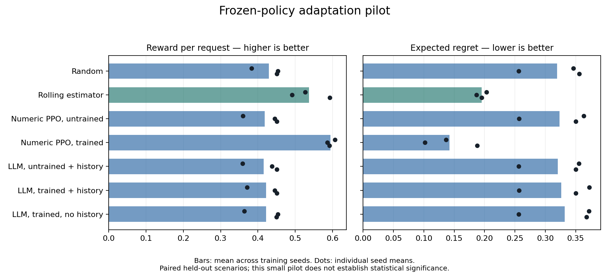

# Controlled adaptation benchmark

This generic benchmark asks whether a frozen policy uses recent outcomes to
choose tools after their reliability changes. Its environment, scoring, and
baseline policies live in `examples/adaptation_benchmark.py`; none of this task
logic belongs to Jormungandr's learner/runtime package. Financial environments,
rewards, data adapters, and production research workflows belong in application
repositories.

## Run

The core-only comparison needs no language-model download:

```bash
python -m pip install -e '.[dev]'
python examples/adaptation_benchmark.py \
  --no-llm --output runs/adaptation-numeric
```

For the language-policy comparison, install the optional dependencies and use a
small pinned model:

```bash
python -m pip install -e '.[dev,llm]'
python examples/adaptation_benchmark.py \
  --model HuggingFaceTB/SmolLM2-135M \
  --revision 93efa2f097d58c2a74874c7e644dbc9b0cee75a2 \
  --device cuda --dtype bfloat16 --max-tokens 1536 \
  --seeds 11,23,37 --rounds 6 --train-trials 2 \
  --eval-trials 4 --steps 32 --history 4 \
  --output runs/adaptation-pilot
```

A local Hugging Face model directory can be supplied instead; in Python call
`run()` with `revision=None`, or on the CLI pass `--revision ''`. CPU runs use
`--device cpu --dtype float32`. All paths and devices are caller-selected.
The benchmark refuses to reuse an output directory containing a configuration
manifest, including an interrupted run. Use a new directory when restarting.

The small default budget is a pilot, not a recommendation for converged training.
It gives each learned policy 384 environment interactions per training seed,
with no reuse of evaluation feedback. Three seeds give three independently
initialized and trained models. Four evaluation trials per seed include two
abrupt-change and two gradual-change scenarios. Increasing trials improves
measurement precision; increasing training rounds changes the learning budget.

## Environment and causality

There are two legal tool routes. Each request has a binary success outcome and
reward

```
success - advertised_cost - 0.1 * advertised_latency
```

Costs and latency quotes are visible and fixed within a trial, but vary between
trials. Success probabilities are hidden. Training trials contain one abrupt
reliability inversion at a random time. Held-out trials contain either two
abrupt inversions at new times or a gradual inversion, a family not encountered
in training. The action does not affect the underlying reliability schedule.

Each scenario pre-generates a table of potential successes for both routes at
every turn. Every evaluated method receives the same schedules and potential
outcomes; selecting a different route cannot advance the world's random stream.
Only the chosen route's outcome is revealed. Unchosen outcomes and hidden
probabilities are available solely to the offline evaluator. The fixed executor
and scorer are environment components, not additional learning policies.

Training and evaluation scenario RNG namespaces are disjoint. Each trial starts with a
fresh `AgentContext`. A request is a one-step episode, and context may persist
across requests within the trial. The policy never sees a regime label, a change
notification, or the future schedule. Tests alter hidden probabilities and
outcomes while checking that the current observation remains identical.

The benchmark uses the learner's public in-process scoring/update interfaces.
The separate `llm_agent_prototype.py` example covers distributed service ingress,
actor IDs, and checkpoint reload. This benchmark isolates adaptation rather than
claiming multi-agent cooperation or independently learning teammates.

## Comparisons

| Method | Available past information | Parameter updates during evaluation |
|---|---|---|
| Random | None | None |
| Rolling estimator | Chosen actions/rewards in the last four requests | None |
| Numeric PPO, before/after training | Per-route recent mean reward, count, and age | None |
| LLM PPO, before/after training | The last four action/outcome/reward records | None |
| Trained LLM without history | Current request and route descriptions only | None |

The rolling estimator tries routes absent from its window; otherwise it chooses
among the largest recent mean rewards with 10% uniform exploration. It has no
access to change times. The numeric policy uses Jormungandr's existing structured
transformer. The LLM policy uses the pretrained backbone, LoRA, and freshly
initialized action/value heads described in `llm_agents.md`.

Both learned policies have the same environment-interaction budget, but their
parameter counts, representation, optimizer settings, and compute cost differ.
The numeric policy receives an explicitly compressed history, while the LLM has
to interpret raw records. This is an engineering comparator, not a claim that
architecture alone explains differences. The within-LLM history ablation uses
the exact same trained weights and current inputs, removing both text history
and every history-derived numeric feature.

The numeric learner uses two PPO epochs; the more expensive LLM uses one.
Episodes are one step with gamma zero: the objective rewards current tool
selection, not the future information value of exploration. This is an initial
adaptation test, not full meta-RL exploration training. The policy is sampled at
evaluation, so uncertainty/exploration affects observed performance. Each method
uses the same per-trial action RNG seed, although different distributions can
produce different actions.

The run fixes its training budget before evaluating results. Pretraining and
post-training evaluations are diagnostics; neither selects checkpoints or
hyperparameters. All evaluation methods start from fresh histories. Changing
settings after inspecting these results would make these scenarios development
data; a later confirmatory study must use new held-out seeds/scenarios.

## Measurements

- **Mean reward:** realized utility after costs and latency charges.
- **Expected regret:** best route's hidden expected utility minus the selected
  route's expected utility. Uses evaluator-only probabilities rather than a
  hindsight-best random outcome.
- **Optimal-action fraction:** choices matching the best expected utility.
- **Non-greedy action fraction:** selected actions whose policy probability is
  strictly below the largest probability. This is only an exploration proxy;
  it is not a causal decomposition of regret into exploration and mistakes.
- **Post-change regret:** regret summed over up to the first eight requests
  after an oracle-best-action change, stopping at the next change.
- **Recovery:** the first completed four-request window with at least three
  optimal choices. Unrecovered cases retain a null delay and their available
  follow-up length; they are not discarded or reported as zero. For gradual
  changes, the reference time is the oracle-best-action crossover. This is a
  descriptive threshold, not proof that the policy detected a regime change.
- **Decision latency:** scoring and action sampling after an unscored initial
  warm-up. Excludes model loading, input construction, diagnostic tokenization,
  and actual external tool execution.

Summaries report means and sample standard deviations of the per-seed means,
separately for abrupt and gradual changes. Paired LLM comparisons list the
reward difference for each training seed and their average. There is no
statistical-significance claim from three training seeds. Individual recovery
observations remain in the per-seed result files.

## Artifacts and invariant checks

Each run writes:

- `configuration.json` before training;
- `provenance.json` with dependency versions and source hashes;
- `source/` with the benchmark and Jormungandr Python source used by the run;
- `scenarios-<seed>.json` with evaluator-only schedules and potential outcomes;
- `traces-<seed>.jsonl` with stage, policy update count, prior history, chosen
  action, behavior probabilities, and observed reward;
- `result-<seed>.json` with every trial's metrics and training diagnostics;
- inference bundles for the trained numeric policies and LLM adapters; and
- `summary.json` with aggregate and paired comparisons.

Evaluation checks that the learned-parameter digest and learner update counter
remain unchanged. The LLM backbone is frozen throughout training and inference.
The history ablation does not create or train a second model. The benchmark
uses `context_diagnostics()` to reject silent history truncation: increase
`--max-tokens` if the entire requested history will not fit.

The source snapshot and generic configuration contain no embedded remote hosts
or private deployment details. Model bundle portability still requires the
matching base model/tokenizer, as documented in the LLM agent guide.

## Interpreting a result

A useful adaptation result should improve over the same model before training
and over the history-free ablation, remain competitive with a simple rolling
estimator, and justify its latency/cost. Inspect per-family and per-seed results,
not only a pooled reward. A declining PPO loss does not establish adaptation.
If the LLM fails these comparisons, this benchmark has identified a limitation;
scaling the model is not automatically the appropriate remedy.

An optional static comparison plot can be generated from a completed run:

```bash
python -m pip install -e '.[plot]'
python examples/plot_adaptation_benchmark.py runs/adaptation-pilot/summary.json \
  --output runs/adaptation-pilot/comparison.png
```

Bars show the mean across training seeds; individual dots show seed means.
They are not confidence intervals.

## Recorded initial pilot

The [recorded results](../benchmarks/adaptation_pilot.json) use the command above:
three training seeds, 384 training interactions per policy/seed, and 12 paired
held-out trials in total. Training plus evaluation took about 295 seconds on a
24 GiB RTX 4090, with approximately 9.8 GiB peak allocated GPU memory. These
runtime numbers are illustrative and exclude package installation/model download.

| Policy | Mean reward | Expected regret | Optimal action | Mean decision time |
|---|---:|---:|---:|---:|
| Random | 0.429 | 0.319 | 51.8% | 0.012 ms |
| Rolling estimator | 0.537 | 0.195 | 69.5% | 0.037 ms |
| Numeric PPO, untrained | 0.419 | 0.323 | 51.0% | 0.862 ms |
| Numeric PPO, trained | 0.595 | 0.142 | 76.8% | 0.878 ms |
| LLM, untrained + history | 0.416 | 0.321 | 51.3% | 51.459 ms |
| LLM, trained + history | 0.422 | 0.326 | 50.3% | 52.005 ms |
| LLM, trained, no history | 0.422 | 0.332 | 50.0% | 47.391 ms |



The numeric policy improves on its initial policy and has higher aggregate
reward than the rolling estimator in this pilot. The LLM's mean reward gain over
its initial policy is only 0.00685, while its gain over the same trained policy
without history is approximately -0.000015. The expected-regret comparison also
does not show an improvement over the untrained LLM. Both trained and untrained
LLM policies are near chance on optimal-action selection.

The traces help distinguish lack of learning signal from a stalled update path:
all six LLM updates per seed report finite nonzero gradient norms, the complete
four-event history fits without truncation, and route probabilities change after
training. However, trained route-A probabilities have within-run standard
deviations of only about 0.005–0.012 across evaluation observations. For one seed
training mostly moves the overall route-A preference to about 0.64, independent
of outcomes. The numeric policy's corresponding probability standard deviations
are about 0.38. These diagnostics suggest a nearly state-independent LLM choice
in this setup; they do not isolate whether representation, optimization,
initialization, model size, or the small data budget is responsible.

The next controlled diagnostic should separate those factors—for example,
training with the same explicit causal summary features used by numeric PPO,
and assessing initialization of the action head—before committing to a larger
model or more expensive hardware. Any follow-up optimization should treat these
pilot scenarios as development data and reserve fresh seeds for confirmation.
