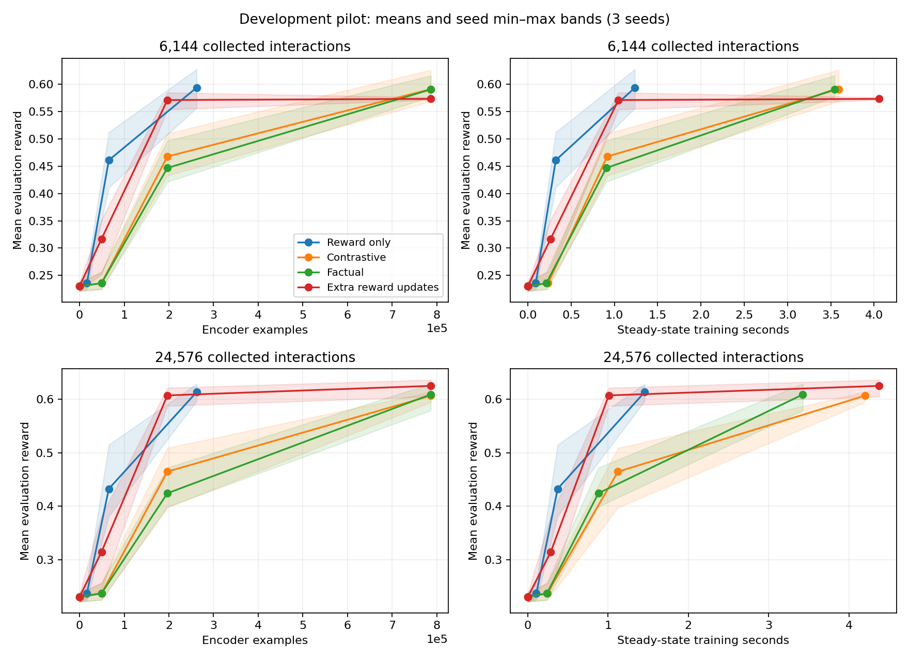

# Context auxiliary objectives: development study

The research question is whether explicit context supervision improves downstream
sample efficiency or training time beyond simply supplying history. The first
pilot does **not establish an acceleration benefit**. This result concerns one
numeric factual objective; it does not replicate or refute the LLM paper.

## Scope and provenance

Inspired by [Context-Aware RL, arXiv:2606.17053v1](https://arxiv.org/abs/2606.17053v1),
we implemented the clipped two-option margin objective and generic auxiliary-loss
composition. The [reference code](https://github.com/xupy2003/ContextAwareRL)
was inspected at commit `0683df934b7c2698fb97df5a478664e1b310db2f`.
Its agentic `ct_policy_worker.py` uses the same clipped log-ratio/log-sigmoid
objective, choosing the maximum log probability among allowed token variants for
each option. Our numeric two-logit objective does not implement that tokenization
path or the reference GRPO trainer.

This is a development-only, immediate-reward contextual learner, not discounted
control or an LLM experiment. Evaluation task families were already consumed in
earlier development. They are not a fresh confirmatory test set. No claims of
publication-ready statistical significance are made from three training seeds.

## Reproduce

From a repository checkout with Python and the package installed:

```bash
python -m pip install -e '.[dev,plot]'
PYTHONPATH=src:. python examples/context_auxiliary_research.py \
  --output runs/context-auxiliary-study \
  --seeds 8101 8203 8309 --trials 64 256 --eval-trials 16
```

The experiment runs on CPU with two PyTorch threads; no private machine names,
remote access, paid services, or trading infrastructure are required. The recorded
runtime used PyTorch 2.4.1 and NumPy 1.26.0. Protocol, source hashes/snapshots,
per-trial results, and model checkpoints are written to the output directory.

Training uses 6,144 or 24,576 collected interactions from three/five-service tasks.
A shared 128-wide two-layer encoder receives the latest 16 calls, candidate flags,
rewards, presence masks, and catalog size. Evaluation uses eight services across
stable, changing, noisy, and harder noisy worlds, with 16 worlds per task/seed.
Each method has its own causal history on matched underlying world tapes.

The auxiliary question is fixed: what was this candidate's latest observed
outcome? A negative swaps that outcome with an older opposite outcome of the same
candidate. Counts, action positions, other-service outcomes, and history length
are unchanged. Option order is randomized. Histories without an eligible opposite
outcome are masked. Labels use observed past rewards, never hidden best actions or
future rewards. Synthetic histories are never treated as genuine reward replay.

Four arms share initial weights, corpus, and architecture:

- **Reward:** one original-reward BCE update per outer step.
- **Contrastive:** reward plus context-selection loss, coefficient 0.1, clip 5.
- **Factual:** reward plus direct latest-outcome BCE on the same paired contexts,
  controlling for additional factual supervision.
- **Extra reward updates:** three reward-only updates per outer step, matching
  auxiliary arms' encoder-example count, not exact FLOPs.

Checkpoints are 0, 128, 512, and 2,048 outer steps. Auxiliary heads exist in all
arms, but are trained only in the contrastive/factual arms. Accuracy of an untrained
head is not a fair representation comparison. Training time includes pair
construction and optimizer work; startup, collection, and evaluation are recorded
separately. A shared throwaway backend warmup precedes fresh seeded models.

## Findings

Mean evaluation reward across four tasks and three seeds at 2,048 outer steps:

| Training interactions | Reward | Contrastive | Factual | Extra reward updates |
|---|---:|---:|---:|---:|
| 6,144 | 0.5941 | 0.5913 | 0.5907 | 0.5734 |
| 24,576 | 0.6137 | 0.6069 | 0.6093 | 0.6253 |

These columns do not have equal compute: auxiliary and extra-update arms process
three times as many encoder examples as reward-only. Average final training times
were respectively 1.24/3.59/3.54/4.06 seconds at the smaller corpus and
1.46/4.20/3.43/4.38 seconds at the larger corpus. These short CPU timings are
hardware-sensitive; encoder-example counts are an additional, imperfect proxy.

At 512 outer steps, extra reward updates reached 0.5713/0.6075 versus
contrastive 0.4678/0.4648. Later, the smaller-data extra-update arm declined.
Thus more updates are not universally better either. The context objective can
learn its factual discrimination task without making the reward policy learn
faster. This predicate may be poorly aligned with belief estimation under noise.



The figure shows means and seed min–max bands, not confidence intervals. Connected
checkpoints do not reveal behavior between measurements. The JSON artifact retains
per-trial results, collection and evaluation times, corpus/source hashes, and the
first observed checkpoint meeting strongest-reference mean minus 0.05. That is
neither exact first-passage time nor proof of sustained convergence.

The initial run included one-time backend startup in its first method's timing.
We repeated the unchanged recipe with shared warmup. All recorded mean reward
curves are identical between runs. The artifact uses corrected v2 timings and
records this correction; no hyperparameters were selected from this repeat.

## Next research stages and literal replication

1. Freeze a new noisy-state benchmark and compare history-only learning against
   objectives for predictive state, change detection, and uncertainty. Include a
   belief/filter baseline and observable-state oracle. Keep hidden-state labels
   confined to an explicitly privileged diagnostic arm.
2. Measure reward versus environment interactions, encoder workload, and wall
   time; retain factual-supervision and extra-update controls. Use several noise
   and regime-persistence levels, paired seeds, and separately reserved worlds.
3. Choose a recipe on development data, then freeze it before fresh confirmation.
   Do not replace a failing reward criterion with auxiliary classification accuracy.
4. Run a separate literal LLM replication using the authors' GRPO setup, rather
   than labeling this numeric generalization a replication.

Before stage 4, pin model/tokenizer, dataset, reference code, and sandbox revisions;
verify option-token variants and teacher-forced positions, patch masking, ambiguous
pair filtering, and loss scaling across microbatches. The paper's agentic recipe
uses 8B models, 7k task examples plus 1k contrastive examples, eight rollouts per
prompt, and context lengths around 28–32k. Appendix D.1 lists clip 5 and auxiliary
coefficients 0.001 for Qwen / 0.005 for Klear. These are not our numeric settings.

Resolve provenance differences before claiming fidelity: the body and appendix
name different training-source mixtures; inspect actual split/filter manifests in
[the released dataset](https://huggingface.co/datasets/xupy21/ContextRL_Agentic)
rather than inferring counts from a collection preview. Appendix E reports
4×H200 140GB and approximately 72 hours per agentic run, whereas the repository
README describes A100/H100 80GB nodes. Establish the configuration actually being
replicated and its resource budget. No full reference-scale run has been launched.

The delivered framework API is described in [Auxiliary objectives](auxiliary_objectives.md).

The next development study is [predictive objectives under noisy state](noisy_state_auxiliary.md).
