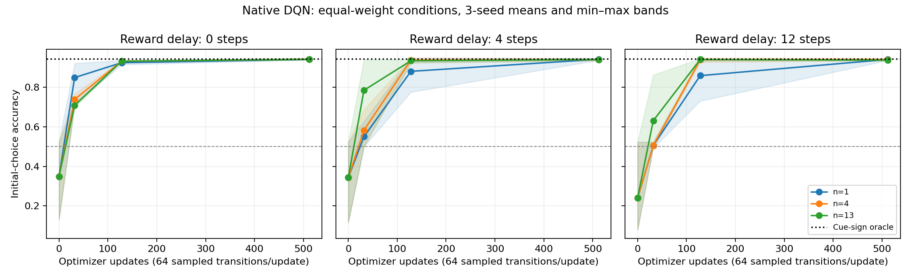

# Delayed feedback and n-step credit assignment

## Audit findings

Reward delay and delivery latency are different problems:

- **Environment delay:** an action affects a reward emitted several transitions
  later. Preserve that reward at its actual environment timestep; the return
  calculation propagates credit backwards.
- **Late receipt:** a reward for an already identified transition arrives later
  over a network. Join it to the original actor/episode/timestep before publishing
  finalized experience. Do not attach it to whichever action is current when it
  arrives, and do not submit a provisional zero as a resolved reward.

The structured transition service validates candidate identity and retains actor,
episode, timestep, split, and policy-version provenance. It does not assemble
chronological episodes, deduplicate submissions, or reconcile reward corrections.
The vector service's delayed `aux_update` endpoint attaches auxiliary labels;
it does **not** update the RL reward. Applications must own pending outcome storage,
receipt correlation, deduplication, and a policy for unresolved/expired outcomes.
A missing outcome is not inherently a zero reward or a negative preference.

The audit found that structured ingress defaulted an omitted reward to zero even
though the protocol documented reward as required. It now rejects omitted or null
rewards before admitting the batch. Explicit zero remains valid. Native structured
DQN previously used one-step targets only. This change adds explicit multi-step
return horizons without changing existing one-step defaults.

There is also a separate limitation outside this change: structured PPO's current
complete-episode GAE path stops at `step.done`, which includes time-limit
truncations. It does not bootstrap such truncations. Do not infer that the DQN
truncation handling added here fixes PPO, vector DQN/C51, or all other learners.

## Native structured DQN support

```python
from jormungandr.returns import n_step_transitions

# Original, finalized transitions from one complete episode, in timestep order.
returns = n_step_transitions(episode, n=4, gamma=0.95)
agent.update_structured(returns)
```

For a return spanning k transitions, the learner uses:

`target = sum(gamma**j * reward[t+j], j=0..k-1) + gamma**k * Q_target(next_state)`

The bootstrap term is omitted for true termination. The converter emits one row
per original transition, preserving its observation, candidate ID, actor,
episode, timestep, split, and policy version. The final next observation and
boundary flags come from the end of the return span. Terminal tails shorten the
actual horizon instead of discounting all tails by the requested n.

New optional structured transition fields:

| Field | Default | Meaning |
|---|---|---|
| `bootstrap_steps` | 1 | Positive integer k; discount bootstrap by gamma**k |
| `return_gamma` | null | Discount used in an aggregated reward; required if k > 1 |
| `truncated` | false | Collection boundary with continuing value |

`done=true` retains its legacy meaning of suppressing bootstrapping. For the new
explicit convention, use `done=true, truncated=false` for true termination and
`done=false, truncated=true` for a time limit. Both flags true are rejected. A
truncation must retain the final pre-reset observation. Changing legacy callers'
meaning of `done` requires an explicit adapter change; the service cannot infer it.
The learner and structured ingress reject a `return_gamma` that differs from the
configured gamma. The optional fields pass through structured HTTP ingress.

The converter accepts complete episodes starting at timestep zero, not arbitrary
replay samples. It rejects mixed actor/episode/split identity, gaps, reordering,
early boundaries, mismatched adjacent observation tensors/IDs, unfinished
sequences, and already aggregated inputs. It checks numeric observation continuity;
applications remain responsible for metadata validity and causal provenance.
It does not silently sort, join, pad, or mark unfinished episodes terminal.

Language DQN's causal history check now allows the next observation to contain
history through the actual return horizon; the original observation's causal
cutoff is unchanged. This is covered by a regression test. The generic converter
does not validate arbitrary application metadata or discover causal labels.

Uncorrected n-step Q targets include rewards from intermediate behavior actions.
When those actions differ from the target policy, they can introduce off-policy
bias. More steps can also increase variance. This addition is opt-in; it is not
an unconditional recommendation to increase n.

## Controlled benchmark

`examples/delayed_credit_benchmark.py` uses the **native StructuredDQNAgent update**,
optimizer, Double-DQN targets, target synchronization, and microbatch machinery.
An example-only small MLP replaces the default transformer architecture to isolate
credit assignment cheaply. There is no separately implemented learner.

Each episode contains one consequential two-option decision followed by forced
wait actions. It lasts 13 transitions regardless of reward delay. A latent sign
produces a noisy cue; the initial choice is right or left. A correct choice earns
+1 and an incorrect choice -1, emitted at step 0, 4, or 12. Independently, feedback
is emitted with probability 1.0 or 0.25; otherwise the **environment reward is
actually zero**, not a missing API outcome. Observation noise is 0.0 or 0.8.

The state includes the original cue, elapsed time, chosen action after the initial
decision, phase, and scheduled delay. It excludes hidden correctness and the
future reward gate. This avoids an artificial memory requirement. Subsequent
actions are forced, so n-step targets do not cross additional behavior-policy
choices. The experiment deliberately does not establish performance on general
multi-decision control tasks.

Compare n=1, 4, and 13, with gamma 0.95, 256 random-choice training episodes per
condition, batch size 64, learning rate 0.003, target synchronization every 20
updates, and checkpoints 0/32/128/512. Training seeds are 10103/10211/10301.
Each condition gets 3,328 collected interactions and 256 consequential choices.
All methods share initial model weights, replay index tapes, episode data, and
1,024 evaluation episodes per seed/condition. Replay sampling is uniform. Model
order is shuffled deterministically. Record collection, return preparation,
steady-state training, and evaluation time separately.

The principal metric is initial-choice accuracy against the latent sign, measured
only by the evaluator. A cue-sign oracle provides an information-matched reference;
it cannot always recover the hidden sign under noise. Random choice has expected
accuracy 0.5. Expected discounted and undiscounted returns are also recorded.
Noise, feedback frequency, and delay vary independently in 12 conditions. These
are development results, not held-out confirmation or a market simulation.

```bash
python -m pip install -e '.[dev,plot]'
PYTHONPATH=src:. python examples/delayed_credit_benchmark.py \
  --output runs/delayed-credit-study
```

## Ranked choices and user feedback

The two-option task is a diagnostic control, not a limitation of Jörmungandr's
candidate representation. Native structured inference already returns aligned
candidate IDs and candidate values. A caller can sort legal candidates into a
shortlist and let a user choose among multiple acceptable answers. These values
are return estimates, not automatically calibrated acceptance probabilities.

A future preference-feedback contract should preserve the displayed candidate
set and ordering, policy/version/context identity, selected candidate (or no
choice), explicit ratings or pairwise preferences, and receipt identity/time.
Selection provides preference evidence, not proof that every unselected option
is wrong. Position bias, exposure, and abstention need explicit treatment.
Preference labels and environment outcomes should remain separately typed;
converting one into RL reward is an application decision.

C51 predicts a categorical **return distribution per action**; ranking options
does not itself require that algorithm. See the
[original distributional RL paper](https://arxiv.org/abs/1707.06887).
Existing ranking metrics can evaluate a shortlist, but this work does not add a
human-preference ingestion endpoint or a pairwise/listwise preference trainer.

## Development results

Mean initial-choice accuracy across the two feedback rates, two noise levels,
and three seeds (12 evaluations per cell):

| Reward delay | Updates | n=1 | n=4 | n=13 |
|---|---:|---:|---:|---:|
| 0 | 32 | 0.8494 | 0.7390 | 0.7083 |
| 0 | 128 | 0.9246 | 0.9320 | 0.9325 |
| 0 | 512 | 0.9414 | 0.9418 | 0.9417 |
| 4 | 32 | 0.5506 | 0.5830 | 0.7853 |
| 4 | 128 | 0.8810 | 0.9377 | 0.9344 |
| 4 | 512 | 0.9421 | 0.9404 | 0.9407 |
| 12 | 32 | 0.5052 | 0.5052 | 0.6315 |
| 12 | 128 | 0.8593 | 0.9403 | 0.9409 |
| 12 | 512 | 0.9413 | 0.9408 | 0.9376 |

N-step returns improve early learning on delayed reward in this controlled setup.
At delay 12 and 128 updates, n=4/13 improve average accuracy by approximately
8.1/8.2 percentage points. Immediate reward favors one-step learning initially.
By 512 updates the methods mostly converge to similar performance, and n=13
finishes slightly worse at the longest delay. This supports an opt-in feature,
not a universal default or a proof that more steps are always better.

Average training times to 512 updates were about 0.76–0.86 seconds across the
nine delay/method aggregates. These are short CPU timings, not portable throughput
claims. Return construction and collection costs are recorded separately. Every
method uses the same fixed corpus, so the result demonstrates earlier learning
at a fixed interaction budget; it does not establish online environment sample
efficiency or deployment performance. Three seeds and development worlds are
insufficient for a broad statistical claim.



Bands show seed min–max after averaging the four noise/feedback conditions within
each seed, not confidence intervals. Step-zero models are randomly initialized
neural policies, not uniform random actions: they can systematically invert the
cue, so their observed accuracy can fall below the random-action reference.

The [JSON archive](../benchmarks/delayed_credit.json) includes all conditions,
paired seed differences, timings, source hashes, and per-episode correctness
encoded losslessly as packed bits. The raw run directory also contains source
snapshots and final native agent checkpoints. Regenerate the report with:

```bash
python examples/delayed_credit_report.py runs/delayed-credit-study \
  --output benchmarks/delayed_credit
```

No recurrence was added: this control intentionally exposes the relevant memory
in the observation, and the result does not demonstrate a need for recurrent
state. Broader experiments should introduce multiple consequential decisions and
check off-policy corrections before drawing conclusions about general n-step
control. The ranked-shortlist feedback contract described above is a separate
next capability, not an implemented preference-learning feature in this change.
