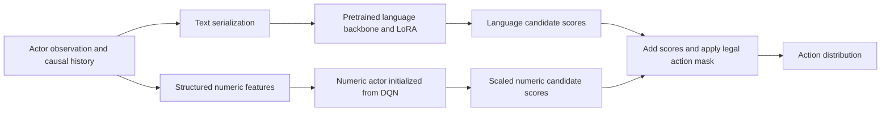

# Hybrid adaptation: preserve a learned numeric skill

A language model need not rediscover a numeric decision rule from serialized
numbers. The hybrid actor keeps a numeric skill alongside language features and
combines their candidate scores. This is optional, generic infrastructure;
the switching-route problem and its training recipe remain examples.



## Reproduce the reward-trained hybrid

From a source checkout with the optional language dependencies:

```bash
PYTHONPATH=src python -m examples.hybrid_adaptation \
  --output runs/hybrid-dqn-confirmation \
  --teacher dqn --seeds 1103,1201,1301 \
  --device cuda --dtype bfloat16
```

The defaults specify a pinned SmolLM2-135M base model. CPU inference/training is
supported with `--device cpu --dtype float32`. Model downloads are needed only
when the pinned weights are not already cached. Output directories cannot be
reused. Inference bundles require the same base model and tokenizer separately.

For each seed, the recipe trains structured DQN on two fixed training worlds for
six collection rounds: 384 reward interactions and 384 uniform replay updates
of 32 samples. All transitions terminate, so this is immediate reward learning,
not a test of long-term bootstrap correctness. The numeric network is a small
entity/candidate transformer with model dimension 32 and one layer.

Its weights initialize the hybrid's numeric actor. The language backbone and
LoRA start independently, with a fresh scalar action head. Numeric Q scores are
scaled by ten before adding language logits. The teacher then supplies soft
labels, `softmax(10 * Q)`, for 64 causal summary observations collected by the
rolling policy on the training worlds. Six single-example epochs fit the joint
actor to those labels, using learning rate 0.0001 for each branch. The teacher
receives no held-out feedback and remains unchanged during student training.

This is a reward-trained numeric skill followed by supervised transfer and
calibration. It is not an experiment in language-only PPO discovering the rule.
The source DQN remains useful without a language model. Its reported standalone
evaluation uses epsilon 0.1, whereas the hybrid samples its learned softmax;
differences between them cannot automatically be attributed to language.

Evaluation covers 12 fresh worlds per seed: six abrupt changes and six gradual
changes, 32 requests each. Parameters remain frozen, and each world starts with
empty actor memory. The hybrid is compared against random and rolling policies,
the source DQN, the same hybrid without history, and each score branch separately.
The latter ablations keep computation in place; their timings do not measure
removing a branch from deployment.

`summary.json` records per-seed means and an explicit aggregate acceptance check:
mean reward and best-route accuracy must be at least the rolling baseline, and
expected regret must be no higher. This is a practical pilot criterion, not a
statistical superiority test or a guarantee for every scenario. Full traces,
source snapshots/hashes, dependency versions, evaluator-only world audits and
reloadable policy bundles are saved alongside the results.

## Why change the pipeline?

The [independent-control experiment](learning_diagnostics.md) found that a small
PyTorch reward learner and Jormungandr DQN both used the summaries successfully,
while the language-only scorer struggled even with supervised labels. Explicit
text-cue fitting succeeded. That narrowed the problem to learning the numeric
feedback rule through the language representation under the tested setup; it did
not establish a general RL implementation failure.

An initial hybrid trained only to imitate the rolling rule nearly matched it on
seeds 701, 809 and 907: reward 0.518 versus 0.511, regret 0.216 versus 0.216, and
accuracy 66.7% versus 67.3%. A numeric-only warm-up with mirrored training examples
also worked on the development seed, but did not demonstrate a clear improvement.
The reward-trained DQN skill supplied a stronger starting point. These earlier
cohorts are development evidence; the final recipe uses the separate cohort in
the command above.

For research, `--teacher rolling` retains rule imitation, and `--warmup-epochs`
plus `--mirror` enables a numeric-only warm-up and route-identity balancing.
Warm-up leaves language parameters unchanged. These options are not part of the
DQN-transfer recipe above. The general import and checkpoint contracts are
specified in [the language-agent documentation](llm_agents.md#optional-numeric-actor-branch).

## Recorded confirmation

The [public artifact](../benchmarks/hybrid_adaptation.json) includes development
results and the separate three-seed confirmation. The final recipe passed the
predeclared aggregate reward, regret and accuracy checks on 36 held-out worlds
(1,152 requests).

| Policy | Best-route accuracy | Mean reward | Expected regret |
|---|---:|---:|---:|
| Hybrid with DQN initialization | **79.6%** | **0.628** | **0.124** |
| Numeric branch alone | 79.4% | 0.626 | 0.126 |
| Source DQN, epsilon 0.1 | 77.5% | 0.619 | 0.136 |
| Rolling estimator | 66.3% | 0.534 | 0.217 |
| Hybrid without history | 52.1% | 0.424 | 0.322 |
| Language branch alone | 51.7% | 0.419 | 0.323 |

Hybrid accuracy by seed is 77.1%, 79.4% and 82.3%, compared with 65.9%, 63.3%
and 69.8% for the paired rolling baseline. This is a successful learned numeric
controller within a language-capable pipeline. Almost all demonstrated capability
comes from the numeric branch; the small difference from the full hybrid does
not establish a useful language contribution. These are small synthetic pilots,
not evidence of domain expertise or market performance.

A subsequent greedy evaluation of the same frozen checkpoints reaches 79.4%
accuracy, versus 79.6% for sampled actions. It does not remove a hidden 80%
framework limit. Choosing different actions changes what is learned about the
routes, so removing exploration can help or hurt an individual scenario. This
post-hoc comparison is included in the artifact; it did not select or retrain a
checkpoint.

```bash
PYTHONPATH=src python -m examples.evaluate_hybrid_greedy \
  --source runs/hybrid-dqn-confirmation --output runs/hybrid-greedy --device cuda
```

The next controlled experiment is broader training-world coverage at a fixed
interaction budget. The present pilots demonstrate useful history-dependent
control and a working numeric-skill transfer path, but do not identify the best
achievable accuracy from four requests of feedback.

Within this confirmation cohort, sampled hybrid accuracy is 76.7% on abrupt
changes and 82.5% on gradual changes. Expected regret is 0.172 and 0.076,
respectively. This further argues against an inherent 80% accuracy limit in the
framework; the score depends on the scenario family and available feedback.
