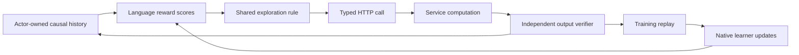
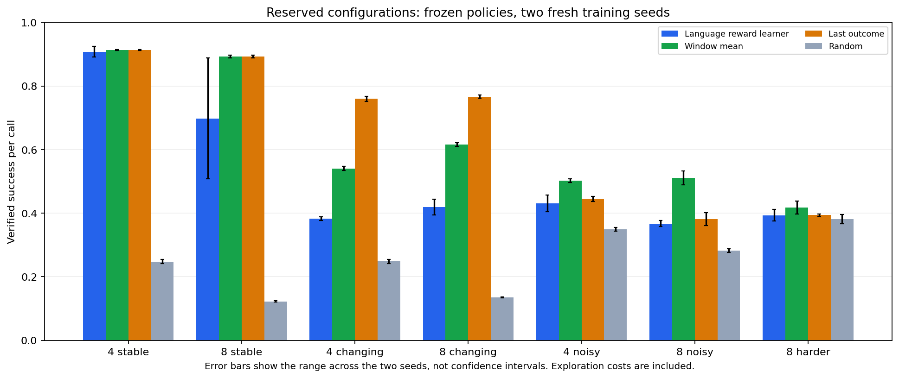

# Multi-service adaptation and executable tools

This extends the [two-service sanity benchmark](context_adaptation.md) to tasks
where one failure cannot identify the best service. It separates learned reward
scores, actor exploration, and independent outcome verification.



During evaluation the replay-to-learner path is disabled: only actor history
changes, while model weights remain frozen.

**Current result: the infrastructure and all four experiment stages are complete,
but reliable learned-policy generalization is not established.** The two fresh
training seeds fail to match simple baselines consistently on reserved tasks.
See the recorded results below; the successful development runs are not sufficient
evidence for deployment.

## Task and information boundary

Training uses 3 or 5 services, success probabilities of 1/0, 0.9/0.1, or 0.75/0.25,
and stable sessions or changes every 12 or 24 calls. Development evaluation uses 4 or 8
services, stable sessions or changes every 16 or 32 calls, and additional
probabilities of 0.85/0.15 and 0.7/0.3. Sessions last 96 calls. Every change chooses
a different best service. Confirmation reserves 112-call sessions, 20/28-call
change intervals, noise levels 0.8/0.2 and 0.65/0.35, additional wording and ID
prefixes, and fresh training seeds. Confirmation tuples are disjoint from both
training and development tuples. The stable controls retain the same underlying
stationary task with a longer horizon.

The actor sees its own selected service and verified outcome, never unchosen
rewards, service reliability, change times, or the best-service index. Its memory
holds the last 16 calls. Each service description includes counts, event age, and
the observed outcome sequence derived from that memory. These are explicit state
preprocessing, not a numeric policy or oracle recommendation. All numeric model
features are zero. Service names are replaced and request wording changes at
evaluation. Candidate order is randomized at every call.

Counterfactual outcome tapes use independent random draws for each service at
each turn. Policies share tapes for paired comparisons, but only receive the
outcome of their chosen call. Naming and order RNGs cannot change latent outcomes.

## Learner and exploration

The native `llm_dqn` plugin trains a LoRA-adapted SmolLM2-135M model on actual
chosen-action rewards. This example uses `gamma=0`: a contextual reward learner,
not a learned long-horizon exploration planner. Collection mixes random choices
and a windowed empirical-mean behavior policy. The latter affects which data are
collected; its preferred actions are not used as training labels. Training IDs
are randomized across three prefixes. Replay draws 25% of samples with zero
previous observations of the chosen service, 25% with one, and 50% with multiple
observations. Stratification depends on public history count, never on reward.
This addresses undercoverage of untried services without inserting answers.

Every evaluated learned or statistical scorer uses the same explicit 10% random
exploration rule. There are no oracle-triggered resets or forced probes after a
change. Exploration costs are included in reward and regret. Learning an
exploration strategy is a separate experiment, and is not established here.

The optional `llm_candidate_context: local` serialization scores a candidate with
its own description, associated entities, and matching past events. It omits
other candidates and local row numbers. This supports different catalog sizes
and order invariance when candidates can be valued independently. It deliberately
cannot represent interactions between alternatives; use the default `joint`
serialization for such problems. Checkpoint identity distinguishes the two.
Local inference also uses canonical microbatch ordering to prevent candidate
permutations from changing padding and reduced-precision rounding.

The optional `llm_attention_implementation: sdpa` reduces attention memory use;
the default remains `eager`. The example uses bfloat16, 512 optimizer updates,
an effective batch of 16, learning rate 0.00003, and bounded forward batches.
`structured_microbatch_size: 2` accumulates gradients across two-sample chunks
with one optimizer step and one target update per effective batch. Importance
weights, priorities, terminal targets, and demonstration normalization are
preserved; a full-batch equivalence test covers uneven chunks. For local scoring
with gamma zero and no demonstration margin, only the chosen candidate needs
to be encoded for the reward loss. A separate equivalence test covers that
optimization. The context limit drops whole oldest raw
events as needed, while the explicit 16-call summary remains in the description.
Thus the summary is part of the information contract; retained raw text alone is
not the complete memory representation.

## Controls and metrics

Controls include random selection, last-outcome memory, a smoothed window mean,
and a window UCB score. Each has its own causal history. History removal and
consistent feedback inversion apply to both descriptions and raw history.
A one-event-history ablation tests evidence accumulation. Reordered evaluation
checks the learned policy with reversed candidate rows. Exact score ties use
service identity rather than row order. Primary comparisons and history removal
use 12 trials per task by default; inversion, one-event history, and reordering
use the first four trials. Their matched full-history reference is recorded
separately, so controls with different trial counts are not compared as if paired.

Report total reward, cumulative reward, pseudo-regret against the currently best
service's expected reward, best-service selection frequency, and exploration
frequency. Report the delay to first selecting the new best service after each
change, with censored changes counted explicitly. That delay can include a lucky
probe; it is not proof of sustained recovery. Trial-level reward standard errors
measure variation within a run, not uncertainty across independent training runs.

## Real HTTP sandbox

`examples/adaptation_tool_sandbox.py` implements a loopback HTTP sorting API with
bounded, typed integer-list arguments and a finite service allowlist. Each service
actually sorts the input. The private environment sometimes injects an incorrect
result according to its reliability schedule. An independent verifier checks
ordering, length, types, and preservation of the input multiset.

The actor resolves the selected candidate ID into a typed `SortCall`, sends an
HTTP request, parses the returned JSON, and derives reward from verification.
Requests, responses, actions, and rewards are recorded. The test also checks that
HTTP execution matches direct simulation for identical outcome tapes. Incorrect
results can have HTTP status 200; transport success is not task success.

Arguments are constructed by the actor, not generated as arbitrary code or JSON
by the LLM. This demonstrates actual tool routing and execution with verified
feedback, not autonomous programming, real external-service reliability, or
semantic selection between different tool functions. All task-specific server
logic stays in examples, outside the generic learner.

## Run

Install the optional `llm` dependencies and run from the repository root:

```sh
PYTHONPATH=src:. python -m examples.multiservice_adaptation \
  --output runs/multiservice-development --device cuda

PYTHONPATH=src:. python -m examples.multiservice_adaptation \
  --output runs/multiservice-baselines --baselines-only
```

Run independent confirmations after selecting and freezing the development recipe:

```sh
PYTHONPATH=src:. python -m examples.multiservice_adaptation \
  --output runs/multiservice-confirmation-4201 --device cuda \
  --stage confirmation --seed 4201
```

Repeat with seed 4303. To evaluate an
exported frozen policy without training:

```sh
PYTHONPATH=src:. python -m examples.multiservice_adaptation \
  --output runs/multiservice-evaluation --device cuda \
  --bundle runs/multiservice-development/language --seed 4201
```

Each run saves its protocol before learning, source snapshots (including the
learner implementation), adapter bundle,
training losses, evaluation metrics, and traces. The standard suite includes 192
actual HTTP calls. No private hostname or external credentials are required.

## Recorded results

[Full results and provenance](../benchmarks/multiservice_adaptation.json) include
failed development runs, both confirmations, controls, and post-hoc diagnostics.
The implementation used for confirmation is commit `9ead6fa`. Source snapshots,
training configurations, reserved world hashes, and actual HTTP trace rewards
were independently checked. Each primary condition has 12 trials of 112 calls
per training seed; all evaluation weights remain frozen.

| Reserved task | LLM seed 4201 | LLM seed 4303 | Last outcome, mean | Window mean, mean | Random, mean |
| --- | ---: | ---: | ---: | ---: | ---: |
| four stable | 92.5% | 89.1% | 91.3% | 91.3% | 24.8% |
| eight stable | 88.8% | 50.8% | 89.3% | 89.3% | 12.2% |
| four changes | 37.6% | 38.8% | 76.0% | 54.1% | 24.9% |
| eight changes | 44.4% | 39.4% | 76.7% | 61.6% | 13.5% |
| four noisy | 40.5% | 45.8% | 44.5% | 50.2% | 34.9% |
| eight noisy | 37.6% | 35.8% | 38.2% | 51.1% | 28.2% |
| eight harder | 37.5% | 41.1% | 39.4% | 41.8% | 38.1% |

These are total verified successes per call, including exploration and change
errors. Noisy tasks have a best-service success probability below 100%. Window
UCB and regret/recovery metrics are also retained in the JSON artifact.



The learned policy is not consistently competitive with the references. In
particular, both seeds perform poorly under the reserved deterministic change
schedules, and the eight-service stable result varies sharply by training seed.
Averaging the seeds would conceal that instability.

Development reached 91.8% and 87.3% on stable four/eight-service tasks, close to
its memory references, after increasing effective batch size, lowering the
learning rate, and improving evidence-count coverage. Those changes were bundled,
not a one-factor causal ablation. Before confirmation, source review also removed
a training-name-prefix/change-schedule correlation and canonicalized inference
microbatches. Both corrections are recorded in the frozen protocol and limit
causal attribution of the development-to-confirmation gap. No confirmation
outcomes were used to retrain or select checkpoints.

The two confirmation tool tests made **384 actual HTTP calls**. Every recorded
reward was rechecked against the returned array, and HTTP execution matched
simulation. This verifies execution and feedback plumbing, not routing quality:
the learned routers achieved 50.0% and 58.9% on those separate noisy sandbox trials.

## Additional information audits

The original history-free scores on small stable cohorts can be high by luck:
a fixed service choice succeeds for the entire session when it happens to be the
winner. Calls within such a trial are not independent samples. The original
scores remain in the artifact.

A post-hoc balanced audit rotates every service through the hidden winning role
while preserving public inputs and exploration randomness. Both frozen models
score exactly **25% with four services and 12.5% with eight**, as required without
feedback. This is an information-boundary check, not a new training result or a
replacement for the original confirmation scores.

```sh
PYTHONPATH=src:. python -m examples.multiservice_balanced_control \
  --output runs/balanced-4201 --device cuda --seed 4201 \
  --bundle runs/multiservice-confirmation-4201/language
```

A second matched post-hoc diagnostic holds dynamics and weights fixed while
canonicalizing opaque service names, request wording, or both. Its four trials
have 64 calls and deterministic changes every 20 calls; these are distinct from
the primary comparison table.

| Seed | Raw inputs | Familiar request | Canonical names | Both |
| --- | ---: | ---: | ---: | ---: |
| 4201 | 45.7% | 44.5% | 44.1% | 44.1% |
| 4303 | 41.0% | 59.4% | 56.6% | 66.4% |

Normalization helps one seed but does not rescue the other. It therefore does
not resolve the generalization failure. The canonicalization example assumes a
single known job type and opaque service identities; it is not a parser for
arbitrary requests and is not promoted as the validated policy.

```sh
PYTHONPATH=src:. python -m examples.multiservice_input_diagnostic \
  --output runs/input-diagnostic-4201 --device cuda --seed 4201 \
  --bundle runs/multiservice-confirmation-4201/language
```

The remaining research problem is robust history-to-value learning across task
changes and training seeds. These results do not isolate whether more varied
training data, a different state representation, optimization changes, or model
capacity will solve it. Further tuning must use development data and reserve new
untouched evaluations; the confirmation cases reported here have been examined.

## Follow-up: learnability and compact evidence

The old confirmation cases have now been inspected and are **development data**.
They must not be reused to claim fresh confirmation of a revised model.

`examples.multiservice_learning_control` is an independent small MLP diagnostic,
not a replacement for the language policy. It learns from actual chosen-action
rewards using candidate-relative public history. It does not see hidden winner
labels, service names, switch times, or success probabilities. Training uses
random change hazards and varied exploration policies. With seed 5101 and 32
worlds per task, the 16-call control obtained rewards of 0.9121/0.8753 on stable
4/8-service tasks and 0.7179/0.6593 on deterministic switching tasks. The matched
last-outcome baseline obtained 0.7852/0.7681 on switching. Increasing history to
64 calls did not solve this gap (0.6892/0.5988). More history is not by itself a
solution, and these results do not demonstrate language-model learning.

```bash
python -m examples.multiservice_learning_control \
  --output runs/learnability --device cuda
python -m examples.multiservice_evidence \
  --output runs/evidence-development --device cuda
```

The language experiment uses the opt-in `llm_candidate_context="evidence"`
serializer. The actor supplies compact public evidence in candidate descriptions;
the serializer excludes opaque routing IDs and does not duplicate raw history in
the model prompt. Raw history is still retained and validated for causal replay.
The actor is responsible for supplying all decision-relevant evidence, including
interactions between alternatives where needed. Oversized evidence raises an
error rather than silently truncating. Existing `joint` and `local` serializers
remain unchanged. Export manifests identify the new serialization separately.

For this example, evidence includes the latest own result, every retained own
result with its relative age, and the chronological self/other outcome stream.
It includes no recommended action, computed policy score, or numeric actor.
The typed job is canonicalized; this does not demonstrate semantic understanding
of arbitrary new API descriptions. An `EvidencePolicy` actor wrapper must also
be used when loading this example's exported bundle so inference receives the
same evidence transformation as training.

`examples.multiservice_acceptance` defines a fixed numerical gate before new
confirmation: at least 32 matched worlds per task, no more than 0.05 mean reward
below the strongest of last-outcome/window-mean/window-UCB, and stable-task floors
of 0.85 (four services) and 0.80 (eight services). It reports paired uncertainty
without relaxing the threshold. Confirmation additionally requires two independent
training seeds and untouched 128-call cases with 22/34-call changes and 0.82/0.18
or 0.68/0.32 success probabilities. A per-run gate pass alone cannot establish
that provenance. Software tests passing is separate from this performance gate.

Matched-budget diagnostics did not identify discounting as the missing fix:
8,000 immediate-reward updates reached 0.7614/0.7084 on switching, compared with
0.7687/0.7070 for discounted Double-DQN (`gamma=0.9`) on the same training corpus.
A larger discounted run worsened noisy-task performance. Broader training
catalogs (3/5/7/9 services, still withholding 4/8) also did not close the switching
gap. These are development diagnostics, not a statistical proof of equivalence.
All runs, including failures, are summarized in
[`multiservice_followup.json`](../benchmarks/multiservice_followup.json).

The static collector left a specific coverage gap: among 20,736 transitions,
none had 15 retained successes followed by a failure for the chosen service.
The compact model consequently kept preferring a previously successful service
after it failed. `examples.multiservice_evidence_online` adds native refinement
from the language policy's own training interactions. It collects actual rewards
on training worlds, then samples 75% recent interactions and 25% initial replay.
Validation worlds never supply updates. The deployment bundle has no optimizer
moments, so refinement deliberately starts a fresh optimizer.

Two rounds of 36 training trials and 256 updates improved seed 5101 from
0.5015/0.5394 to 0.8073/0.7597 on four/eight-service switching development tasks.
These are matched worlds; the strongest baselines scored 0.7909/0.7738. All seven
12-world development comparisons met the numerical tolerance. This preliminary
result alone does not establish confirmation or seed robustness.

```bash
python -m examples.multiservice_evidence_online \
  --bundle runs/evidence-development/language \
  --output runs/evidence-online --seed 5101 --device cuda
```

Frozen bundle evaluation, including permutation and actual HTTP checks, is
available separately:

```bash
python -m examples.multiservice_evidence_validation \
  --bundle runs/evidence-online/round-2 \
  --output runs/evidence-validation --stage development \
  --seed 6101 --trials 32 --device cuda
```

This command exits nonzero when the performance gate fails. Use `--stage
confirmation` only after development succeeds; consuming those results makes
them unavailable for another claim of untouched confirmation.

The first refinement was not seed-robust: seed 5203 obtained 0.4189 on noisy
eight-service routing against a 0.4866 window-mean baseline. The follow-up
`counts_v2` format adds public success/failure/observation counts to the existing
recency and chronological evidence. It does not add a recommended action,
smoothed policy score, or transferred numeric actor. The measured follow-up uses
256 warmup updates followed by two additional on-policy rounds on new training
worlds:

```bash
python -m examples.multiservice_evidence_online \
  --bundle runs/evidence-online/round-2 \
  --output runs/evidence-counts --seed 5101 --device cuda \
  --evidence-format counts_v2 --warmup-updates 256 --collection-offset 20000
python -m examples.multiservice_evidence_validation \
  --bundle runs/evidence-counts/round-2 \
  --output runs/evidence-counts-validation --stage development \
  --seed 6101 --trials 32 --device cuda \
  --observation-batch-size 32 --inference-batch-size 128
```

The validation runner reads `example_evidence_format` from the bundle manifest.
Custom actors must pass that format to `EvidencePolicy`; omitting it selects the
original `v1` format. Larger inference batches and duplicate-prompt elimination
reduce evaluation cost without changing reward definitions, the information boundary, or the
acceptance threshold. More refinement and changed inputs are combined in this
experiment, so its improvement cannot be attributed to the count fields alone.
