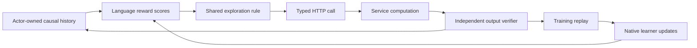

# Multi-service adaptation and executable tools

This extends the [two-service sanity benchmark](context_adaptation.md) to tasks
where one failure cannot identify the best service. It separates learned reward
scores, actor exploration, and independent outcome verification.



During evaluation the replay-to-learner path is disabled: only actor history
changes, while model weights remain frozen.

## Task and information boundary

Training uses 3 or 5 services, success probabilities of 1/0, 0.9/0.1, or 0.75/0.25,
and stable sessions or changes every 12 or 24 calls. Development evaluation uses 4 or 8
services, stable sessions or changes every 16 or 32 calls, and additional
probabilities of 0.85/0.15 and 0.7/0.3. Sessions last 96 calls. Every change chooses
a different best service. Confirmation reserves 112-call sessions, 20/28-call
change intervals, noise levels 0.8/0.2 and 0.65/0.35, additional wording and ID
prefixes, and fresh training seeds. Confirmation tuples are disjoint from both
training and development tuples. The stable controls retain the same underlying
stationary task with a longer horizon.

The actor sees its own selected service and verified outcome, never unchosen
rewards, service reliability, change times, or the best-service index. Its memory
holds the last 16 calls. Each service description includes counts, event age, and
the observed outcome sequence derived from that memory. These are explicit state
preprocessing, not a numeric policy or oracle recommendation. All numeric model
features are zero. Service names are replaced and request wording changes at
evaluation. Candidate order is randomized at every call.

Counterfactual outcome tapes use independent random draws for each service at
each turn. Policies share tapes for paired comparisons, but only receive the
outcome of their chosen call. Naming and order RNGs cannot change latent outcomes.

## Learner and exploration

The native `llm_dqn` plugin trains a LoRA-adapted SmolLM2-135M model on actual
chosen-action rewards. This example uses `gamma=0`: a contextual reward learner,
not a learned long-horizon exploration planner. Collection mixes random choices
and a windowed empirical-mean behavior policy. The latter affects which data are
collected; its preferred actions are not used as training labels. Training IDs
are randomized across three prefixes. Replay draws 25% of samples with zero
previous observations of the chosen service, 25% with one, and 50% with multiple
observations. Stratification depends on public history count, never on reward.
This addresses undercoverage of untried services without inserting answers.

Every evaluated learned or statistical scorer uses the same explicit 10% random
exploration rule. There are no oracle-triggered resets or forced probes after a
change. Exploration costs are included in reward and regret. Learning an
exploration strategy is a separate experiment, and is not established here.

The optional `llm_candidate_context: local` serialization scores a candidate with
its own description, associated entities, and matching past events. It omits
other candidates and local row numbers. This supports different catalog sizes
and order invariance when candidates can be valued independently. It deliberately
cannot represent interactions between alternatives; use the default `joint`
serialization for such problems. Checkpoint identity distinguishes the two.
Local inference also uses canonical microbatch ordering to prevent candidate
permutations from changing padding and reduced-precision rounding.

The optional `llm_attention_implementation: sdpa` reduces attention memory use;
the default remains `eager`. The example uses bfloat16, 512 optimizer updates,
an effective batch of 16, learning rate 0.00003, and bounded forward batches.
`structured_microbatch_size: 2` accumulates gradients across two-sample chunks
with one optimizer step and one target update per effective batch. Importance
weights, priorities, terminal targets, and demonstration normalization are
preserved; a full-batch equivalence test covers uneven chunks. For local scoring
with gamma zero and no demonstration margin, only the chosen candidate needs
to be encoded for the reward loss. A separate equivalence test covers that
optimization. The context limit drops whole oldest raw
events as needed, while the explicit 16-call summary remains in the description.
Thus the summary is part of the information contract; retained raw text alone is
not the complete memory representation.

## Controls and metrics

Controls include random selection, last-outcome memory, a smoothed window mean,
and a window UCB score. Each has its own causal history. History removal and
consistent feedback inversion apply to both descriptions and raw history.
A one-event-history ablation tests evidence accumulation. Reordered evaluation
checks the learned policy with reversed candidate rows. Exact score ties use
service identity rather than row order. Primary comparisons and history removal
use 12 trials per task by default; inversion, one-event history, and reordering
use the first four trials. Their matched full-history reference is recorded
separately, so controls with different trial counts are not compared as if paired.

Report total reward, cumulative reward, pseudo-regret against the currently best
service's expected reward, best-service selection frequency, and exploration
frequency. Report the delay to first selecting the new best service after each
change, with censored changes counted explicitly. That delay can include a lucky
probe; it is not proof of sustained recovery. Trial-level reward standard errors
measure variation within a run, not uncertainty across independent training runs.

## Real HTTP sandbox

`examples/adaptation_tool_sandbox.py` implements a loopback HTTP sorting API with
bounded, typed integer-list arguments and a finite service allowlist. Each service
actually sorts the input. The private environment sometimes injects an incorrect
result according to its reliability schedule. An independent verifier checks
ordering, length, types, and preservation of the input multiset.

The actor resolves the selected candidate ID into a typed `SortCall`, sends an
HTTP request, parses the returned JSON, and derives reward from verification.
Requests, responses, actions, and rewards are recorded. The test also checks that
HTTP execution matches direct simulation for identical outcome tapes. Incorrect
results can have HTTP status 200; transport success is not task success.

Arguments are constructed by the actor, not generated as arbitrary code or JSON
by the LLM. This demonstrates actual tool routing and execution with verified
feedback, not autonomous programming, real external-service reliability, or
semantic selection between different tool functions. All task-specific server
logic stays in examples, outside the generic learner.

## Run

Install the optional `llm` dependencies and run from the repository root:

```sh
PYTHONPATH=src:. python -m examples.multiservice_adaptation \
  --output runs/multiservice-development --device cuda

PYTHONPATH=src:. python -m examples.multiservice_adaptation \
  --output runs/multiservice-baselines --baselines-only
```

Run independent confirmations after selecting and freezing the development recipe:

```sh
PYTHONPATH=src:. python -m examples.multiservice_adaptation \
  --output runs/multiservice-confirmation-4201 --device cuda \
  --stage confirmation --seed 4201
```

Repeat with seed 4303. To evaluate an
exported frozen policy without training:

```sh
PYTHONPATH=src:. python -m examples.multiservice_adaptation \
  --output runs/multiservice-evaluation --device cuda \
  --bundle runs/multiservice-development/language --seed 4201
```

Each run saves its protocol before learning, source snapshots (including the
learner implementation), adapter bundle,
training losses, evaluation metrics, and traces. The standard suite includes 192
actual HTTP calls. No private hostname or external credentials are required.
