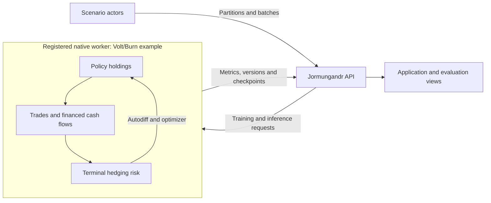

# Application API for native learners

A hedging policy learns from whole market scenarios. Each update follows positions, trading costs and cash flows through those scenarios before measuring the final hedging risk. This API lets scenario-producing actors submit complete batches, request training updates, evaluate held-out paths and retrieve a versioned policy for inference.

Jormungandr can control a persistent native learner through its HTTP service. A native worker owns the policy, optimizer, resident scenario tensors and autodiff graph. Actors submit complete scenario batches. Updates refer to an uploaded batch and an expected model version.



Jormungandr supervises the process through the protocol. Financial calculations and live autodiff tensors stay inside the selected worker. Other native engines can implement the same protocol and register under their own backend names.

The first backend is Volt's Rust/Burn `native_learner`. Build it from the Volt checkout:

```sh
cargo build -p volt-compute --release --bin native_learner
```

In the Jormungandr environment, register the installed executable and start the service:

```sh
export VOLT_LEARNER_BIN=/absolute/path/to/volt/target/release/native_learner
jormungandr-service --host 127.0.0.1 --port 8080
```

Run two concurrent scenario-producing actors against that service:

```sh
python examples/native_hedging.py --url http://127.0.0.1:8080 --paths 64 --updates 20
```

This example uses synthetic European option prices. It creates a continuous stock/option policy, uploads one validation batch and two training batches, performs 40 versioned updates, evaluates the retained validation scenarios and deletes its worker. `--checkpoint /path/to/state.json` saves the policy, Adam state, configuration and dataset partitions before cleanup. Historical-data preparation belongs in a separate application.

For fused Metal execution on an Apple silicon Mac, build the Volt worker with `--features metal,fusion`, register that executable and run the example with `--target metal`. The example then selects f32. `--precision` overrides the precision, and `--backend` selects another administrator-registered worker. Status reports `fusion_compiled` and `fusion_active`; the Flex CPU route remains eager even when GPU fusion is compiled into the same executable. Volt currently rejects CUDA plus fusion because of an existing pricing-accuracy guard.

## HTTP operations

| Method | Route | Result |
|---|---|---|
| GET | `/v2/native/backends` | Registered backend names, protocols and limits |
| POST | `/v2/native/models` | Create from `{model_id, backend, config}` or restore from `{model_id, backend, checkpoint}` |
| GET | `/v2/native/models` | Native model identifiers |
| GET | `/v2/native/models/{id}` | Model version, configuration and resident-batch count |
| POST | `/v2/native/models/{id}/register_dataset` | Declare immutable `{dataset_id, partitions}` split ranges |
| POST | `/v2/native/models/{id}/upload` | Retain `{batch_id, split, batch}` on the native device |
| POST | `/v2/native/models/{id}/update` | Train `{batch_id, expected_version}` once |
| POST | `/v2/native/models/{id}/evaluate` | Evaluate `{batch_id, retain_holdings}` with unchanged weights |
| POST | `/v2/native/models/{id}/infer` | Continuous targets from `{step, paths, features, previous_holdings}` |
| POST | `/v2/native/models/{id}/checkpoint` | Return a portable checkpoint object |
| POST | `/v2/native/models/{id}/drop_batch` | Release `{batch_id}` tensors |
| GET | `/v2/native/models/{id}/metrics` | Last 256 update/evaluation records, including complete request latency |
| DELETE | `/v2/native/models/{id}` | Stop the worker and release its resources |

`JormungandrClient` exposes `create_native_model`, `get_native_model`, `native_command` and `delete_native_model`. The service adds an `ok` field to responses; remove that wrapper field before using a checkpoint as a restore payload.

The service administrator registers executable commands. HTTP callers select those names. Additional native backends can be registered through `JormungandrRuntime(native_backends=...)` using a `NativeBackend` specification and the same command protocol. Policy-engine names and numerical capabilities are validated by the selected worker. Existing vector and structured Torch learners keep their current API and algorithms.

## Versioning and failure recovery

An update requires the current model version. Concurrent actors that receive a stale-version rejection can read the current version and submit again. A completed update increments the version once. A transport timeout stops the worker and reports an unknown update outcome; recover from a saved checkpoint rather than replaying the request automatically.

Actors register immutable dataset identities with disjoint `train`, `validation` and `test` path ranges. An upload identifies its dataset and first path; the batch must fit wholly inside a partition with the declared split. Registration retries are idempotent, and split assignments survive checkpoint/restart. Only training batches permit updates. A 600,000-path study can use three range descriptors while streaming small batches through the learner. The producer owns source identity, market-data chronology and scenario provenance.

Native requests and responses are capped at 16 MiB. The service permits four native models, and the Volt worker permits four resident batches subject to its configured memory admission budget. Serialized provenance metadata has a separate configurable allowance, defaulting to 1 MiB. Trajectory count is represented by exact u64 ranges rather than a per-path list. These estimates govern workload admission; process memory and device allocation should also be monitored for deployment. Native worker timeouts default to 60 seconds and are administrator configurable.

## Initial scope and checks

Volt exposes `volt_time_mlp`: a separate two-hidden-layer MLP at each date with optional previous-holdings feedback, continuous vector output and BatchNorm disabled in this native profile. Its `volt_shared_lstm_reset` engine shares two single-step LSTM layers and two dense layers across dates; previous holdings and optional financed wealth provide the financial history. Both engines use the same training, inference and checkpoint operations. The financed cash recurrence supports per-instrument transaction and liquidation costs, per-interval cash growth and instrument income growth. Objectives are squared error, downside squared error, empirical fractional-tail CVaR and entropic risk. CPU/f64 is the initial integration control. Metal/f32 and CUDA execution require the corresponding Volt build and separate end-to-end validation.

Tests compare the financed recurrence with an independent scalar cash ledger, check parameter gradients against finite differences, and require identical next updates after checkpoint restoration. Set `VOLT_LEARNER_TEST_BIN` to run the real Rust worker through the HTTP integration test:

```sh
VOLT_LEARNER_TEST_BIN="$VOLT_LEARNER_BIN" python -m pytest tests/test_native_learner.py -q
```

The [stock-and-option hedging tutorial](latex/hedging/volt_jormungandr_option_hedging.pdf)
develops the market model, cash accounting, objective and application calls.
Its [LaTeX source](latex/hedging/volt_jormungandr_option_hedging.tex) and
[complete client example](../examples/native_hedging_api.py) are maintained in this repository.

## Early exercise and dividend payments

The same upload and update calls support exercise-aware Volt batches. A scenario
producer first follows the holder's exercise rule along a path. It sends
`exercise: {settlement_step: [...], settlement_amounts: [...]}` with one entry
per path and zero terminal `payoffs`. The writer's policy trades until settlement,
closes its hedge, pays the signed liability and carries the remaining cash to
the common final date. Positive settlement amounts are amounts owed by the writer.

Optional `cash_income` supplies payments per held instrument unit with layout
`[path, interval, instrument]`. Optional `initial_wealth` supplies per-path starting
capital, useful for continuation-value interval hedging. Omitting it uses the
configured premium. Evaluation identifies the comparison date through
`pnl_reference: "common_terminal_bank_account_after_settlement"`.

Volt's [Bermudan scenario application](https://github.com/ingvor-restrat/volt/blob/main/docs/bermudan-market.md)
constructs these batches with dated exercise, cash dividends, a numerical holder
rule and a financed delta control. The [worker account documentation](https://github.com/ingvor-restrat/volt/blob/main/crates/volt-compute/docs-native-learner.md#exercise-and-intermediate-cash-payments)
defines event order and units. Jormungandr forwards the batch through the selected
backend and preserves version checks, split identities and optimizer continuation.
Clients finish the contract's action sequence when settlement occurs.

The real-worker HTTP integration test covers both terminal-only and early-settled
batches, including signed payments, intermediate cash income, per-path capital
and the identical next training update after checkpoint restoration.
