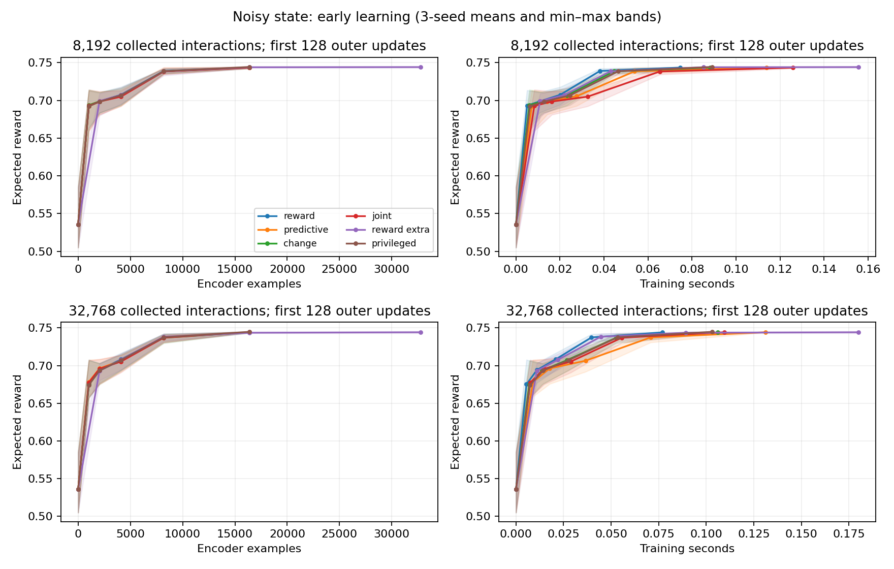

# Predictive context objectives under noise

This development study asks whether auxiliary prediction improves a reward policy
when history is noisy and the relevant hidden state changes. It follows the
[context-discrimination pilot](context_auxiliary_research.md). It is a numeric
contextual-bandit experiment, not a replication of ContextRL or a trading result.

## Fixed protocol

A binary hidden state flips with probability 0.01 or 0.10 per step. The observed
sensor is the state encoded as -1/+1 plus Gaussian noise, with standard deviation
0.7 or 1.5. A correct action succeeds with probability 0.8; an incorrect one with
probability 0.2. Actions do not affect state transitions or sensors. Policies see
16 causal sensor values and presence masks, excluding hidden states, simulator
parameters, and reward history. Omitting reward history deliberately isolates
learning from noisy exogenous context; this is not a complete belief-state agent.

Training data uses uniformly random actions. Rewards are sampled only for the
chosen action. Each corpus contains 32 or 128 episodes of 256 interactions,
equally divided across the four noise/hazard combinations. The last eight rows of
each episode supply future targets but are not training examples: 8,192/32,768
collected interactions yield 7,936/31,744 training rows. No label crosses an
episode boundary. Larger corpora contain the smaller corpus as a prefix.

Three seeds (9109, 9209, 9311), checkpoint steps (0, 128, 512, 2048), batch size
128, Adam learning rate 0.001, and coefficient 0.1 per auxiliary objective were fixed
before viewing results. After observing near-convergence at step 128, an unchanged
repeat added checkpoints 8, 16, 32, and 64 to resolve early learning. This is a
measurement refinement, not a fresh confirmatory experiment. All arms have the same two-layer, 64-wide shared encoder
and all heads. Models and base batch tapes are paired by seed/corpus. Method order
is shuffled deterministically. No coefficient or model selection is performed.

| Arm | Training objective beyond chosen-action reward BCE |
|---|---|
| Reward | None |
| Predictive | Gaussian negative log likelihood for sensor readings 1, 4, and 8 steps ahead |
| Change | BCE for whether the next sensor differs by more than 1.5 |
| Joint | Both predictive and change losses, each weighted 0.1 |
| Extra reward | Two independent reward-only updates per outer step |
| Privileged | Hidden-state classification; diagnostic only |

Future sensor values are **targets**, never policy inputs. Their availability at
training time requires waiting for subsequent observations. The change target is
an observable measurement-change event, not a simulator regime-switch label: it
can be triggered by noise. Predictive mean and variance approximate a mixture
with a Gaussian; variance is predictive uncertainty, not epistemic uncertainty.
The joint arm has twice the summed coefficient budget of either individual arm,
so it is not an isolated interaction-effect test.

All auxiliary heads share the original encoder forward. Thus they add head,
loss, and backward work, not extra encoder examples. The two-update control is an
upper training-work control, **not an exact FLOP match**. We report encoder-example
counts and measured steady-state CPU training seconds, with shared throwaway
backend warmup. Collection and evaluation time are separate. Short wall timings
are hardware-sensitive.

Evaluation uses disjoint seeded episodes: 32 per task and training seed, including
an interpolation condition (noise 1.0, hazard 0.05). These are development worlds,
not a reserved confirmation set. Since actions do not affect sensors, every arm
can use exactly the same causal contexts. The main metric is expected reward of
its greedy action, computed by the evaluator from hidden state. This reduces
outcome sampling noise without exposing hidden state to the deployed policy.
We also record reward-probability MSE and, only for trained heads, predictive
NLL/MSE, standardized squared residuals, and observable-change Brier score.

Reference policies are last sensor, window mean, exact Bayesian filtering with a
16-observation window, full-history Bayesian filtering, and latent-state oracle.
Both filters know the true noise and hazard, unlike learned policies; the oracle
also sees the hidden state. These are information-advantaged diagnostic references,
not matched-data learned competitors. The oracle's expected reward is 0.8.

## Reproduce

From a checkout with the package installed:

```bash
python -m pip install -e '.[dev,plot]'
PYTHONPATH=src:. python examples/noisy_state_auxiliary.py \
  --output runs/noisy-state-study
```

The script runs on CPU using two PyTorch threads. It saves source snapshots/hashes,
protocol, corpus hashes, per-episode evaluation results, timings, and final model
weights. Tests check causal inputs, future-target alignment, episode boundaries,
filter correctness against explicit hidden-path enumeration, absence of hidden
label use in reward-only training, and shared-encoder/auxiliary-head gradients.

## Interpretation boundary

A useful outcome requires improved downstream reward per interaction or training
cost, not merely a lower auxiliary loss. The privileged arm tests whether stronger
state supervision could help, but cannot establish a deployable method. If it
helps and observable prediction does not, label/task alignment remains a plausible
limitation. If neither helps, representation capacity, optimization, and baseline
strength need examination before adding more objectives. Any selected recipe
needs fresh, frozen confirmation; this small study cannot establish a general
acceleration claim.

## Results

Final mean expected reward across all five tasks and three seeds, at 2,048 outer
updates (extra reward has 4,096 optimizer updates):

| Collected interactions | Reward | Predictive | Change | Joint | Extra reward | Privileged |
|---|---:|---:|---:|---:|---:|---:|
| 8,192 | 0.74205 | 0.74262 | 0.74213 | 0.74265 | 0.73401 | 0.74240 |
| 32,768 | 0.74563 | 0.74587 | 0.74568 | 0.74584 | 0.74591 | 0.74579 |

Predictive/joint final improvements are approximately 0.02–0.06 percentage points
of expected reward. These small development differences do not establish a
material or generalizable improvement. The more aggressively trained reward arm
also loses performance late at the smaller corpus; training longer is not a
reliable remedy.

The denser repeat reproduces every original checkpoint reward exactly. At the
larger corpus, predictive training briefly improves mean expected reward at steps
8/16 (0.67829/0.69623 versus 0.67515/0.69415), but falls behind reward-only at step
32. There is no sustained early acceleration in the recorded curves. Average
final training times for reward/predictive/change/joint/extra/privileged are
1.16/1.73/1.45/1.84/2.33/1.31 seconds at the smaller corpus and
1.21/1.74/1.59/1.84/2.59/1.48 seconds at the larger corpus. These CPU timings are
illustrative, not hardware-independent performance guarantees.

Across the same evaluation worlds, last-sensor selection averages 0.70141,
history-mean selection 0.68055, the windowed known-parameter filter 0.75904,
the full-history known-parameter filter 0.75913, and the state oracle 0.80000.
The tiny difference between the two filters suggests that, **in these regimes**,
retaining much more than 16 sensor samples is unlikely to close the learned
policy's remaining gap by itself. Known simulator parameters give these filters
an advantage; this is not proof that the neural architecture cannot match them.

Auxiliary predictions improve on their own tasks. At the larger corpus, the
predictive arm's mean forecast NLL (without the Gaussian constant) decreases from
1.4301 to 0.7863, and its mean standardized squared residual from 3.1875 to 1.0396.
The change arm's Brier score decreases from 0.2602 to 0.1902. A near-unit aggregate
standardized residual alone does not establish conditional calibration. Neither
improved forecast scoring nor privileged state labels produce a substantial final
reward gain here.

The complete learning curves, per-episode rewards, paired seed differences,
timings, and provenance are in
[`benchmarks/noisy_state_auxiliary.json`](../benchmarks/noisy_state_auxiliary.json).
The plot below resolves the first 128 updates. Bands are seed min–max ranges,
not confidence intervals; connected sparse measurements do not show intermediate
training behavior.



To regenerate the archive and plot from a completed run:

```bash
python examples/noisy_state_report.py runs/noisy-state-study \
  --output benchmarks/noisy_state_auxiliary
```

## What this changes about the next experiment

Do not make auxiliary prediction a default on the strength of this study. The
framework can express and test it, but these tasks already give a small MLP a
strong, dense reward signal. A next study should vary reward sparsity/delay and
observation informativeness while preserving the controls, rather than searching
for a favorable coefficient on these consumed worlds. Another useful diagnostic
is a matched-input learner that explicitly predicts a belief distribution and
uses it to choose actions; auxiliary state supervision here only influences the
reward head through a shared encoder. That is a distinct architectural experiment,
not evidence supplied by the current results.
