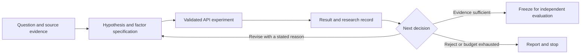

# Quantitative research agents: notes and implementation plan

Status: proposed; implementation has not started under this plan.  
Recorded: 23 November 2026.  
First application: a bounded earnings-factor research workflow.

## Purpose

The LLM project is intended to produce a useful quantitative researcher. A user
should be able to describe an investment idea, have it expressed as a precise
factor, and follow a sequence of experiments that establishes whether the idea
deserves further work. The agent should use the results to choose its next
experiment and eventually explain why it advanced, rejected, or stopped.

The model supplies domain interpretation and proposes the next research action.
Quantitative tools calculate the evidence under explicit assumptions. Portfolio
optimization becomes a downstream experiment once a factor has sufficient
support and the caller has the required permissions.

Two learning processes operate on different schedules. Within a research run,
the agent revises hypotheses while its model weights remain fixed. Between
runs, reviewed research episodes can train a better research policy. Keeping
these schedules separate makes decisions reproducible and lets us evaluate a
model update before using it in further research.

The existing RL algorithms and infrastructure paper remains separate from the
[LLM application paper](latex/jormungandr_llm_adaptation.pdf). This plan describes
the broader application that motivates the LLM work. Planned capabilities must
remain distinguishable from measured results in future publications.

## Starting point and gaps

The repository already contains language-policy components that score bounded
candidate actions. The [language-agent documentation](llm_agents.md) describes
the interface, and the [tool-selection study](multiservice_adaptation.md)
records a trained policy evaluated against history-based rules. That experiment
establishes a limited tool-selection result; it does not establish domain
expertise, general factor research, or autonomous strategy discovery.

The separate application backend has a conversational factor-definition path
and a private research executor for a supported earnings template. Generic
research definitions still require an approved executable evaluator. Creating
a saved definition is distinct from materializing a factor or publishing a
canonical factor product. These boundaries must be rechecked against the
application repositories when implementation begins.

Domain PDFs are available from the project owner, but their folder, contents,
and suitability for training have not yet been inspected. No domain-adaptation
result is claimed at this stage.

## Domain knowledge and training

The PDFs should serve both as an inspectable reference library and as source
material for reviewed teaching examples. Extraction must retain page identity,
publication date, and edition. Equations and tables need special attention;
a text extraction that changes a formula can teach an incorrect calculation.

Begin with a capable language model using retrieval from this library. Establish
its performance before choosing whether continued domain pretraining or
supervised adaptation is worth the additional work. Domain pretraining can
improve familiarity with specialist language. Supervised examples can teach
application: defining a factor, recognizing a timing error, or selecting an
experiment that distinguishes competing explanations. Both require evaluation
on material excluded from training.

Teaching examples should include complete research interactions, with actual
tool results and a reviewed decision about what follows. Retain failed and
inconclusive experiments. A useful researcher should recognize that evidence
is missing or that a hypothesis has failed. Synthetic examples need checks
against their source and quantitative calculation before admission to training.

Assess domain competence through tasks such as translating an economic claim
into a measurable signal, recognizing overlapping labels, and interpreting a
factor result without attributing unsupported significance to it. Split related
source passages and example families together to reduce leakage across the
training and evaluation sets.

## Research loop

A deterministic controller owns execution. It validates a proposed action
against the supported tools and enforces the remaining research budget. The
model cannot grant itself a permission, change the evaluation rules, or turn
an unsupported definition into executable code.

Raw market observations remain on the server. Tool responses expose only
approved analytical outputs, with a review of whether combinations of outputs
could reconstruct prohibited source data. The model should receive sufficient
information to interpret coverage and limitations without receiving raw price
series. All interaction uses the approved API/MCP surface.

Long-running research jobs need durable identities and status transitions.
Retries should retrieve or resume the existing job where possible. Completion
should push a result notification to the session, and a disconnected client
should be able to recover the job status within its authorization and retention
rules. A temporary public session remains temporary even if private audit
records are retained.

### Example: earnings ignition

The initial hypothesis is that an unusual overnight move after earnings,
accompanied by strong volume, predicts continuation over the next few sessions.
Before evaluation, specify the observation time and the universe. Define the
historical baseline and ensure that the signal uses information available at
the decision. The forward-return label begins after that decision.

The first result should establish whether the factor can be calculated and how
many observations support its IC. If the apparent effect is concentrated in
one period, the next experiment should investigate that finding. It could
compare the factor with ordinary momentum or examine whether the volume
condition adds information. A revision should state which prior observation
motivated it and what result would weaken the revised hypothesis.

A supported factor can later be examined for incremental usefulness in a
portfolio after existing exposures and costs are considered. A high IC alone
is insufficient to establish investability. Portfolio construction and
backtesting remain separately authorized; free-tier factor research must not
acquire portfolio privileges through the agent.

## Evaluation and stopping

Numerical convergence of an optimizer is different from resolving a research
question. Define the research outcomes before starting:

| Outcome | Required interpretation |
| --- | --- |
| Advance | A frozen candidate meets the predeclared development requirements and proceeds to independent evaluation. |
| Reject | The results undermine the mechanism or show insufficient incremental usefulness. |
| Inconclusive | The budget is exhausted, evidence is unavailable, or further permitted experiments have low expected value. |

Phase 0 must set concrete thresholds for the first study. Requirements should
address sample adequacy and stability across the declared evaluation periods.
Where a portfolio experiment is authorized, include its cost and exposure
assumptions. Record the stopping budget and the permitted revision space.
A valid negative finding is a successful research outcome.

The controller should separate data used for exploratory feedback from data
reserved for final evaluation. It should also account for all attempted
variants, including failed, discarded, and parallel-agent proposals. Repeated
selection changes the strength of the evidence. A final test repeatedly exposed
to the research loop becomes another development set.

Point-in-time inputs are necessary, but pretrained model knowledge and later
publications can still influence the choice of a historical hypothesis. Date
filters on retrieval cannot erase that knowledge. Describe retrospective work
as research conducted today on historical observations. A stronger prospective
test freezes the hypothesis and model version before new observations arrive,
then evaluates forward. Preserve the timing limitations of reconstructed data.

## Several agents working together

Start with one researcher and a deterministic evaluator. Once the loop can be
measured, several researchers may explore distinct explanations under a shared
budget. A reviewer can challenge timing assumptions or propose a falsification
test. Roles can initially share a model; independently trained specialist
policies are a later experiment.

All agents need a common experiment registry. It should identify duplicate
proposals, preserve failed variants, and track access to evaluation results.
Parallel workers must have explicit compute allocations and ownership rules.
Agreement among models using the same evidence is correlated judgment; a vote
cannot replace an independent quantitative check.

Compare this arrangement with the single-agent workflow under an equal total
budget. Measure additional useful conclusions and failure rates alongside
latency and cost. Add coordination complexity only where the comparison
supports it.

## Learning a research policy with Jörmungandr

The first usable workflow can use an existing capable LLM with retrieval and
tools. Its reviewed episodes then provide training material for improved tool
use and experiment selection. The small model in the tool-routing study should
be treated as evidence for that component, not as an established general
research model.

For a later research-policy experiment, observations would include the current
hypothesis, permitted actions, and returned evidence. Candidate actions might
request a diagnostic, revise a supported parameter, or stop. This fits the
existing bounded-action policy interface. Free-form explanation and proposal
generation can remain a separate component while the learned policy selects
among validated candidates.

Begin with supervised training on reviewed decisions. Consider reinforcement
learning once the evaluator can reliably distinguish useful research actions.
Invalid experiments should fail explicit validation before execution. Among
valid runs, rewards can reflect how much an action resolves a stated uncertainty
relative to its computational cost. Reward design and coefficients need their
own experiment; optimizing backtest profit alone invites selection artifacts.

Development rewards and model-selection tasks must be separate from the final
research evaluation. Freeze policy versions during runs, evaluate proposed
updates on excluded task families, and retain a rollback path. Queries or
clicks should not automatically become training labels. Preference records
can supplement verified outcomes after their interpretation has been reviewed.

## Implementation phases and exit criteria

The phases below are planned work. Completion requires evidence recorded against
the criterion, rather than the presence of an interface or a saved definition.

| Phase | Work | Exit evidence |
| --- | --- | --- |
| 0 — Specify the first experiment | Inspect PDFs and current APIs; choose the earnings template; set the universe, timing rules, budgets, and evaluation boundaries. | A reviewed research protocol with concrete acceptance and stopping criteria; a capability inventory distinguishing implemented operations from gaps. |
| 1 — Establish domain competence | Build the cited document library and reviewed domain tasks; compare the existing model with retrieval; test adaptation only where warranted. | Results on excluded questions and task families, including timing-error detection and source-grounded interpretation. |
| 2 — Execute one complete workflow | Define validated tool contracts and the experiment record; connect factor creation, research jobs, analytical results, and notifications. | A reproducible run from a user idea to a real server result, including failed-job recovery and ownership checks. |
| 3 — Run a bounded research loop | Add state transitions, revision lineage, stopping, and independent final evaluation. | A single agent completes the earnings study and reports advance, reject, or inconclusive against the fixed protocol. Compare with a fixed research procedure at equal budget. |
| 4 — Train better research decisions | Curate reviewed episodes; evaluate supervised adaptation, then a bounded-action RL policy if the evaluator supports it. | Improvement over the frozen baseline on excluded research tasks, with comparable budgets and no worsening of validity checks. |
| 5 — Evaluate collaboration | Add parallel hypotheses and review under a shared registry and budget. | A measured benefit over the single-agent baseline, with all trials and evaluation accesses accounted for. |
| 6 — Broaden the research scope | Add approved factor evaluators and authorized portfolio studies; establish forward evaluation. | New tool families pass their own contracts and evidence checks before becoming available to an agent. |

### Minimal experiment record

The application-owned record should carry:

- Run identity, owner, hypothesis, and parent revision.
- Source citations and their dates, with the model and tool versions used.
- A precise factor definition and its input-availability assumptions.
- Universe, decision clock, label horizons, and evaluation split identity.
- The authorized budget and stopping requirements fixed at run creation.
- Validated tool requests, job receipts, returned analytics, and failures.
- The reason for the next action and the evidence it refers to.
- Final disposition and the identity of the frozen candidate, where applicable.

Use server-issued identifiers and immutable revisions. A record of a proposed
operation must remain distinguishable from a completed tool receipt. Preserve
the full trial history for selection analysis and reproducibility.

### Responsibility boundaries

Jörmungandr should provide reusable policy learning and trajectory handling.
The application backend owns factor semantics, market-data access, and numerical
evaluation. An orchestration layer owns research state and budget enforcement;
Terminal displays progress and the resulting research record. Authentication
and entitlement enforcement remain in the application service layer.

The first deliverable is research, not unattended trading. Any later brokerage
or execution workflow requires its own explicit authorization and controls.

## Next working session

- [ ] Locate and inventory the PDFs; inspect representative equations and tables.
- [ ] Review the actual factor API capabilities and current data-readiness limits.
- [ ] Write the first earnings research protocol and its fixed evaluation budget.
- [ ] Define development feedback and independent evaluation access separately.
- [ ] Specify the experiment record and run/job lifecycle using the existing APIs.
- [ ] Assemble a small reviewed set of valid, invalid, and inconclusive research tasks.
- [ ] Implement and measure the single-run workflow before enabling automatic revision.

Open decisions include the corpus scope, local model and compute budget, the
first evaluator's exact thresholds, and the retention and training eligibility
of user-owned research. Source availability and usage permissions should be
recorded when documents or research episodes enter the corpus.

## Background reading

- Lewis et al., [Retrieval-Augmented Generation for Knowledge-Intensive NLP Tasks](https://arxiv.org/abs/2005.11401).
- Gururangan et al., [Don't Stop Pretraining: Adapt Language Models to Domains and Tasks](https://arxiv.org/abs/2004.10964).
- Yao et al., [ReAct: Synergizing Reasoning and Acting in Language Models](https://arxiv.org/abs/2210.03629).
- Bailey et al., [The Probability of Backtest Overfitting](https://www.davidhbailey.com/dhbpapers/backtest-prob.pdf).

These references motivate parts of the approach. They do not establish the
performance of the proposed financial research system.
