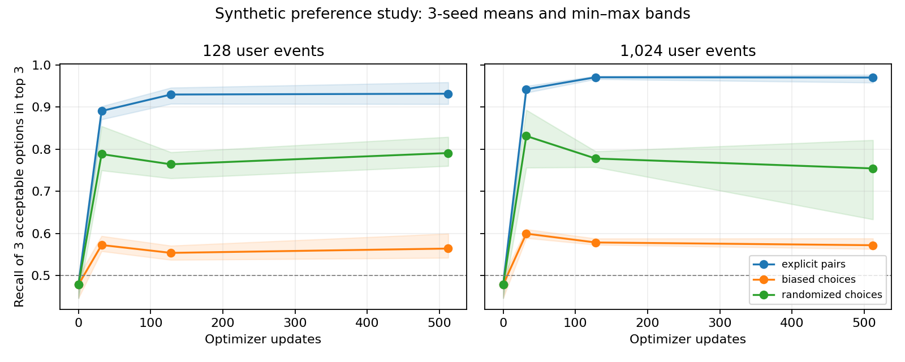

# Ranked shortlists and preference feedback

Jörmungandr now provides library primitives for recording what a user saw and
what they preferred. Multiple displayed answers may be acceptable. A selection
is not automatically converted into correctness labels for the other answers.
The synthetic study below exercises these primitives; it does not tune an LLM.

## What belongs in the core

`jormungandr.preferences` supplies:

- `ranked_shortlist`: sort legal candidates by score, breaking ties by semantic ID.
- `RankedExposure`: immutable record fields for exposure identity, actor/episode/
  timestep, policy version, display time, observation, actual display order,
  aligned scores, split, and optional display-policy probability.
- `PreferenceFeedback`: independently identified receipt containing a choice,
  abstention, normalized ratings, explicit comparisons, or a combination.
- `PreferenceLedger`: bounded in-memory join with exact-retry idempotency,
  conflicting-ID rejection, snapshot storage, and split-filtered retrieval.
- `preference_examples`: explicit comparisons by default; choice-derived
  preferences only through an explicit opt-in.
- `pairwise_preference_loss` and `preference_batch_loss`: differentiable logistic
  preference objectives, including ties and a training-split guard.

Applications own answer generation, feature/context construction, display policy,
user interaction, persistence, and the meaning of ratings. There is no new HTTP
endpoint, registered learner plugin, automatic online update loop, or conversion
of preference into environment reward in this change. These primitives can be
used in an application-owned trainer or composed with the existing auxiliary-loss
API; choosing that objective and coefficient remains explicit.

## Present and record a shortlist

```python
from jormungandr.preferences import RankedExposure, PreferenceFeedback
from jormungandr.preferences import PreferenceLedger, ranked_shortlist

shortlist = ranked_shortlist(observation, candidate_scores, k=3)
exposure = RankedExposure(
    exposure_id="request-17:view-1",
    actor_id="presenter",
    episode_id="request-17",
    timestep=0,
    policy_version=12,
    shown_at_ns=1000,
    observation=observation,
    displayed_ids=tuple(key for key, score in shortlist),
    displayed_scores=tuple(score for key, score in shortlist),
)
ledger = PreferenceLedger(capacity=10000)
ledger.add_exposure(exposure)
ledger.add_feedback(PreferenceFeedback(
    feedback_id="receipt-23",
    exposure_id=exposure.exposure_id,
    received_at_ns=2000,
    selected_id=shortlist[1][0],
))
```

The scores need not be probabilities. A presentation policy can reorder the
shortlist, including for exploration; record the **actual order shown**, not just
the model's preferred order. `display_probability`, when supplied, means the
probability of that entire displayed ordered list under the logging policy. It
is not an examination probability, per-position propensity, or a model confidence.
No automatic propensity correction is performed.

`exposure_to_payload`/`exposure_from_payload` use schema
`jormungandr.ranked_exposure.v1`; feedback equivalents use
`jormungandr.preference_feedback.v1`. Both preserve semantic IDs and support JSON
round trips. The underlying observation serializer now records
`entities.feature_dim`, fixing lost shape information for empty entity arrays.
Legacy empty-entity payloads can also be decoded with an explicit model spec.

## Preserve the difference between signals

A feedback record can contain:

| Signal | Interpretation |
|---|---|
| `selected_id` | The user chose this displayed candidate. |
| `abstained=true` | No selection was made; not a negative label for every candidate. |
| `ratings` | Application-normalized scores in [0, 1], retained without automatic conversion. |
| `comparisons` | Explicit preference between two displayed candidates. |

`PairwisePreference(first_id, second_id, target)` uses target 1 for first preferred,
0 for second preferred, and 0.5 for an explicit tie. Two answers being acceptable
does not necessarily mean the user considers them equally good; acceptability
and relative preference are separate concepts. Equal ratings can be preserved
without inventing a forced winner.

By default, `preference_examples(exposure, feedback)` emits only explicit
comparisons. Ratings, abstention, and a bare selection produce no training rows.
With `infer_selection=True`, a choice yields the assumption that the chosen item
is preferred to each other displayed item. That is weak preference supervision,
not binary rejection. Explicit comparisons override inferred preferences for the
same unordered pair. This assumption can fail when users do not examine every
option or favor earlier positions; the benchmark deliberately demonstrates it.

```python
from jormungandr.preferences import PairwisePreference, preference_examples
from jormungandr.preferences import preference_batch_loss

comparison = PreferenceFeedback(
    feedback_id="receipt-24",
    exposure_id=exposure.exposure_id,
    received_at_ns=3000,
    comparisons=(PairwisePreference(shortlist[0][0], shortlist[1][0], 0.5),),
)
examples = preference_examples(exposure, comparison)
# logits: [examples, padded candidate count], aligned to each original
# observation.candidate_ids, not to the display order.
loss = preference_batch_loss(logits, examples)
loss.backward()
```

The objective is BCE-with-logits on `score(first) - score(second)`. A shared score
shift has no effect. Tie targets favor equal scores. Optional weights multiply
rows; the denominator remains the full batch size, so uneven microbatch gradients
compose correctly. When one feedback event produces several pairs, the caller
must choose event weighting/sampling deliberately; pair-uniform sampling can give
longer lists more influence. The experiment uses constant list size and equal
numbers of derived pairs per event within each method.

## Joining, validation, and limits

Feedback may arrive before exposure; it stays pending until the matching exposure
arrives. The join rejects references to undisplayed candidates, receipts dated
before presentation, duplicate comparison pairs, illegal displayed candidates,
and conflicting reuse of exposure/feedback IDs. A retry with the exact same ID
and payload returns `False` and creates no second event. Different IDs are treated
as different events: application-level retry identity must therefore be stable.

The ledger stores serialized snapshots so later mutation of caller-owned NumPy
arrays or mappings cannot change admitted evidence. Split comes from the exposure;
feedback cannot override it. Display and receipt timestamps must be comparable
in the caller's clock domain; the ledger does not synchronize clocks. `resolved(split="train")` excludes validation records,
and `preference_batch_loss` rejects validation examples before constructing a loss.
The lower-level tensor loss cannot inspect provenance; its caller owns split checks.

Capacity is bounded separately for exposures and feedback, with no silent eviction.
Full capacity raises an error. This is a single-process library join, not durable
storage or a synchronized service. The caller owns persistence, namespaces,
concurrency, unresolved-record expiry, and correction/quarantine workflows. An
invalid pending receipt prevents its exposure from being admitted; it is not
silently discarded. Resolved records can be read repeatedly, so consumers must
track training progress separately. There is no automatic exactly-once training.

## Controlled development study

The example generates six candidates per context. A fixed utility function of
context–candidate interactions orders them; the best three are deemed acceptable
**by the evaluator only**. The linear scorer can represent the planted utility.
Utility and acceptability labels never enter policy inputs.

Three feedback arms share contexts, candidate features, initial weights, update
counts, and exposure counts:

1. **Explicit pairs:** a random candidate pair gets a preference label, with
   5% reversal noise and explicit ties for utility differences below 0.15.
2. **Biased choices:** a logging policy orders candidates by their first raw
   feature; the simulated user picks the first option 80% of the time, otherwise
   samples according to utility. Selection is converted to five assumed pairs.
3. **Randomized choices:** the same choice mechanism sees a uniformly randomized
   display order, decoupling position from the logging feature.

The display order is not a scorer input. Nevertheless, biased clicks can teach
the scorer to favor the feature used by the logging policy. Randomization can
reduce that confounding; it does not turn noisy clicks into explicit judgments.
The simulator's 80% position effect is a deliberate stress condition, not an
estimate of real users. Annotation effort and label quality are **not equalized**:
one explicit pair judgment is different from one selection event. The study tests
the feedback contract and assumptions, not superiority per unit of human effort.

Seeds 11113/11213/11311; 128 or 1,024 events per arm; six candidates; batch 64;
Adam learning rate 0.03; 512 updates with checkpoints 0/32/128/512. Evaluation uses
2,048 independently generated contexts per seed, reused across arms. This is a
development set, not a reserved confirmation set. No hyperparameter search was
performed. Wall times are diagnostic only; no training-speed conclusion is drawn.

```bash
python -m pip install -e '.[dev,plot]'
PYTHONPATH=src:. python examples/shortlist_preference_benchmark.py \
  --output runs/shortlist-study
python examples/shortlist_preference_report.py runs/shortlist-study \
  --output benchmarks/shortlist_preference
```

The run saves actual exposure/feedback events, source snapshots and hashes,
checkpoints, and metrics. The first attempted run stopped before training on the
empty-entity serialization bug. The reported run follows that fix, with unchanged
simulation/training settings. A final repeat after adding compatibility with
native masked (negative-infinity) scores reproduced all recorded ranking metrics
exactly and supplied the archived timing measurements.

## Results

Mean metrics across three seeds after 512 updates:

| Events | Feedback | Top-1 acceptable | Recall of acceptable options in top 3 | Best-option accuracy |
|---|---|---:|---:|---:|
| 128 | Explicit pairs | 0.9951 | 0.9320 | 0.8743 |
| 128 | Biased choices | 0.5877 | 0.5640 | 0.2907 |
| 128 | Randomized choices | 0.9012 | 0.7910 | 0.6086 |
| 1,024 | Explicit pairs | 0.9989 | 0.9704 | 0.9466 |
| 1,024 | Biased choices | 0.6045 | 0.5719 | 0.2987 |
| 1,024 | Randomized choices | 0.8540 | 0.7544 | 0.5744 |

A uniform random ranking has expected top-1 acceptability and top-3 acceptable
recall of 0.5, and best-option accuracy of 1/6. Explicit comparisons recover the
planted preferences well. Position-biased choices remain weak. Randomized display
helps here but is still noisy; its larger-data result is worse at this fixed
training schedule, so more click data alone is not a guarantee of improvement.



Bands are seed min–max, not confidence intervals. The
[JSON artifact](../benchmarks/shortlist_preference.json) retains individual seed
results and the protocol. This small, realizable synthetic problem is a pipeline
check, not evidence of real-user quality, universal sample efficiency, or improved
LLM generation. The promoted capabilities are the records, validated joins,
shortlist utility, and explicit preference losses; no feedback assumption becomes
a default reward policy.
